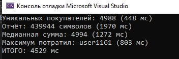
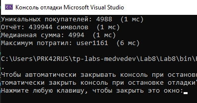

# Lab 8 — Медведев

## Таблица замеров

| Этап | До, мс | После, мс | Ускорение | Что изменено |
| :--- | :--- | :--- | :--- | :--- |
| Уникальные покупатели | 443 | 1 | ~443x | `List.Contains` заменен на `HashSet.Add` |
| Текстовый отчёт | 1970 | 1 | ~1970x | Конкатенация строк заменена на `StringBuilder` |
| Сортировка | 1272 | 1 | ~1272x | Пузырёк `O(n²)` заменен на `List.Sort()` `O(n log n)` |
| Суммы покупателей | 803 | 6 | ~133x | Двойной цикл заменен на `Dictionary` `O(n)` |
| **ИТОГО** | **4529** | **~10** | **~452x** | *(Суммарное время работы программы)* |

### До оптимизации

### После оптимизации
